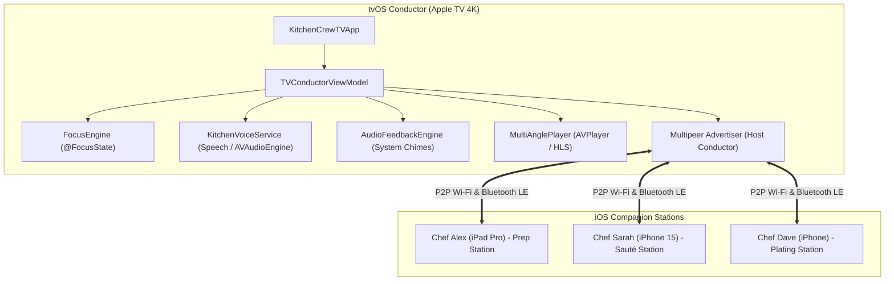

# KitchenCrew: Technical Architecture Specification

## 1. System Overview & Architecture Diagram

KitchenCrew follows a distributed Master-Worker (Conductor-Substation) topology powered by Apple's ecosystem frameworks (`SwiftUI`, `MultipeerConnectivity`, `Speech`, `AVFoundation`, and `Combine`).



---

## 2. Component Breakdown

### 2.1. Apple TV Host Conductor (`KitchenCrewTV`)
* **`TVConductorViewModel`**: Observable master conductor maintaining the centralized `KitchenSession` state, step progression, camera selection, and master kitchen timers.
* **`MultiAngleVideoPlayerView`**: Frame-accurate multi-angle player supporting instant switching between Wide Shot, Pan Macro Sizzle, and Overhead Plating, alongside a synchronized Split-Screen dual-stream view.
* **`BigScreenTimerView`**: 10-foot legibility timers with 44pt monospace numerals, radial progress dials, and audible/visual alert pulses when under 30 seconds.
* **`CrewStationStatusStripView`**: Real-time HUD showing connected household members, active subtasks, and completion percentages.
* **`QuickActionModalView`**: Modal customizer triggered by clicking the Siri Remote trackpad to make instant ingredient substitutions (e.g., dairy-free, allergen-free).
* **`VoiceWaveformOverlayView`**: Siri-like animated waveform displaying real-time speech feedback and intent acknowledgement.

### 2.2. iOS Companion App (`KitchenCrewCompanion`)
* **`CompanionStationViewModel`**: Station-specific view model receiving step updates from the TV, displaying assigned tasks (Mise-en-place vs. Pan Searing), providing local haptic feedback, and transmitting task completion signals back to the Apple TV.
* **`StationChecklistView`**: Touch-optimized checklists designed for iPads and iPhones stationed on kitchen counters.

---

## 3. Communication & Synchronization Protocol

### 3.1. Multipeer Packet Schema (`SyncPayload`)
State is synchronized across devices via encoded Swift `Codable` structs:

```swift
public enum SyncPayload: Codable {
    case stepChange(newIndex: Int)
    case taskCompleted(userId: String, taskId: String, newProgress: Double)
    case timerUpdate(timer: KitchenTimer)
    case timerAlert(timerId: UUID, message: String)
    case cameraAngleChanged(angle: CameraAngle)
    case ingredientSubstituted(ingredientName: String, substitution: String)
}
```

### 3.2. Step Prerequisite Gating
Steps define dependencies using `dependsOnStepId`:
```swift
RecipeStep(
    id: 4,
    title: "Hard Sear: The 90-Second Sear",
    instruction: "Crank pan heat until smoking hot. Sear untouched for 90 seconds.",
    assignedStation: .saute,
    recommendedAngle: .macroPan,
    durationSeconds: 90,
    requiresTimer: true,
    dependsOnStepId: 3 // Requires Step 3 (Render Pancetta) to be marked complete
)
```

---

## 4. Voice Processing Pipeline

Kitchen environments feature high background acoustic noise. The speech recognition pipeline implements three layers of noise suppression:

1. **Near-field Hardware Filtering**: Utilizes the beamforming microphone array on the Siri Remote or paired HomePod to isolate directional voice audio from ambient kitchen noise.
2. **Culinary Context Priming**: Configures `SFSpeechAudioBufferRecognitionRequest.contextualStrings` with specialized vocabulary (e.g., *"arrosé"*, *"shallots"*, *"sear"*, *"mousseline"*), reducing phonetic hallucination.
3. **Deterministic Intent Classifier**:
   - `nextStep`: "next", "continue", "done", "step complete"
   - `previousStep`: "back", "previous"
   - `startTimer`: regex-extracted integers + unit detection ("seconds" / "minutes")
   - `switchCamera`: "pan", "macro", "wide", "chef", "plating"
   - `toggleSplitScreen`: "split screen", "dual", "both"
   - `querySubstitution`: "substitute", "replace", "alternative"

---

## 5. tvOS 10-Foot Design Guidelines Compliance

| tvOS Guideline | KitchenCrew Implementation |
| :--- | :--- |
| **Viewing Distance** | Designed for 10–15 feet viewing distance with 32pt+ headers and 44pt+ monospace timer digits. |
| **Focus Engine** | Strict `@FocusState` compliance; all interactive cards scale up by 1.05x with dynamic specular sheen and shadow depth on focus. |
| **Siri Remote Ergonomics** | Swipe left/right on trackpad moves between steps; clicking the trackpad opens culinary quick tweaks; Play/Pause toggles active timers. |
| **Safe Margins** | 48pt horizontal padding and 32pt vertical padding to comply with tvOS overscan and screen edge restrictions. |
| **Audio Feedback** | System audio cues triggered on focus movement (1104), step completion (1025), and timer completion (1005). |
