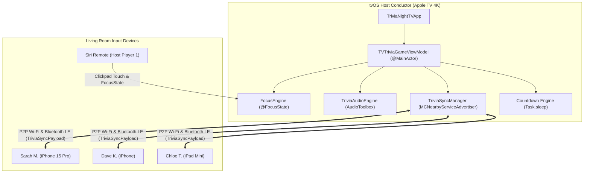

# TriviaNight TV: Technical Architecture Specification

## 1. System Overview & Topology

TriviaNight TV transforms the living room Apple TV 4K into an interactive pub quiz arena. Built native to the Apple ecosystem using **SwiftUI for tvOS**, **FocusEngine**, **MultipeerConnectivity**, and **Swift Concurrency**, the game coordinates simultaneous multi-user buzzer lock-ins across Siri Remotes and paired iPhones without third-party servers.



---

## 2. Component Breakdown

### 2.1. Apple TV Host Conductor (`TriviaNightTV`)
* **`TVTriviaGameViewModel`**: `@MainActor` state manager that drives the full trivia game lifecycle (`lobby`, `categorySelect`, `countdown`, `questionActive`, `answerReveal`, `scoreboard`, `finalPodium`). Calculates real-time speed bonuses and consecutive streak multipliers.
* **`LobbyView`**: 10-foot room overview displaying the local room code (`PUB-4K`), live connected player pills, controller badges, and Siri Remote focusable start button.
* **`CategorySelectView`**: 2D grid of 7 distinct category packs (Movies, Tech, Mathematics & Logic, Music, Pub Trivia, History, Gaming) with FocusEngine scaling.
* **`QuestionTimerBoardView`**: High-impact question screen featuring 36pt rounded typography, an animated 15-second countdown progress bar that shifts from emerald green to amber to pulsing red, and 4 colored answer cards (A, B, C, D) displaying real-time player lock-in avatars.
* **`AnswerRevealView`**: Highlights the correct answer in glowing emerald green, displays a "Trivia Curio" educational fact, and itemizes points earned with speed bonuses.
* **`RoundScoreboardView`**: Live leaderboard displaying rank badges (#1 Gold, #2 Silver, #3 Bronze), total scores, and consecutive hot streak flame indicators.
* **`WinnerCelebrationView`**: 3D-styled celebratory podium with 1st, 2nd, and 3rd pedestals, golden crown fanfare, and pub quiz MVP awards ("Longest Hot Streak", "Accuracy Ace").

### 2.2. iOS Companion Buzzer App (`TriviaNightCompanion`)
* **`CompanionBuzzerViewModel`**: Connects automatically to the Apple TV over zero-configuration Bonjour Multipeer Connectivity, manages player profile state (`playerName`, `selectedAvatar`, `selectedColorHex`), broadcasts `.playerJoin(player:)` updates to the TV, and transmits timestamped answer packets.
* **`CompanionBuzzerView`**: Two-stage mobile interface:
  1. **Pre-Game Profile Setup**: Clean input screen with nickname `TextField`, avatar selection grid, buzzer color picker, and "Join Game on TV 🚀" action.
  2. **Active Buzzer View**: Touch-optimized interface with 4 large colored quadrant buttons (A, B, C, D) matching the big screen cards with tactile press responses, locked-in visual confirmation, and an "Edit Name" quick toggle.

---

## 3. Communication & Synchronization Protocol

### 3.1. Multipeer Packet Schema (`TriviaSyncPayload`)
Device communication uses native Swift `Codable` packets streamed over peer-to-peer Wi-Fi and Bluetooth LE without requiring internet access:

```swift
public enum TriviaSyncPayload: Codable {
    case playerJoin(player: Player)
    case playerAnswer(playerId: String, answerIndex: Int, timeElapsed: Double)
    case hostStateUpdate(stateName: String, questionIndex: Int, timeRemaining: Double)
    case gameRestart
}
```

### 3.2. Low-Latency Speed Scoring Algorithm
Points are rewarded based on both accuracy and reflex speed:

$$\text{Points} = \left(\text{Base Points} + \text{Speed Bonus}\right) \times \text{Streak Multiplier}$$

1. **Base Points**: 1,000 pts per correct answer.
2. **Speed Bonus**: Up to +500 pts scaled linearly: $\text{Bonus} = \text{round}\left(500 \times \frac{t_{\text{remaining}}}{t_{\text{total}}}\right)$.
3. **Streak Multiplier**: Consecutive correct answers stack a 1.25x to 2.0x multiplier, igniting flame badges in the living room HUD.

---

## 4. Concurrency & Timer Pipeline

TriviaNight TV implements drift-free countdown timing via modern Swift Concurrency (`Task` and `Task.sleep`):

```swift
private func startCountdownTimer() {
    timerTask?.cancel()
    timerTask = Task {
        while self.isTimerRunning && self.timeRemaining > 0 {
            try? await Task.sleep(nanoseconds: 100_000_000) // 100ms precision
            if Task.isCancelled { break }
            
            self.timeRemaining = max(0, self.timeRemaining - 0.1)
            
            // Audible cue on integer seconds when urgent (< 5s)
            if self.timeRemaining <= 5.0 && self.timeRemaining > 0 {
                let rounded = round(self.timeRemaining * 10) / 10
                if rounded.truncatingRemainder(dividingBy: 1.0) == 0 {
                    self.audioEngine.play(.timerTick)
                }
            }
            
            if self.timeRemaining <= 0 {
                self.evaluateRoundAnswers()
                break
            }
        }
    }
}
```

---

## 5. tvOS 10-Foot Design Guidelines Compliance

| tvOS Guideline | TriviaNight TV Implementation |
| :--- | :--- |
| **Viewing Distance (10-Foot)** | 32pt+ heavy question prompts, 64pt room code, and 48pt category cards optimized for 10–15 feet living room visibility. |
| **FocusEngine (@FocusState)** | Strict focus state compliance: cards scale up by 1.06x with white specular border highlights and drop shadows upon remote selection. |
| **Siri Remote Ergonomics** | Swipe on clickpad navigates the 2x2 grid smoothly; center press locks in the host answer; Back button returns to previous menu. |
| **Safe Margins** | 48pt horizontal margins and 32pt vertical margins prevent content clipping on television overscan boundaries. |
| **Responsive Audio Feedback** | AudioToolbox system chimes on remote click (1104), countdown tick (1103), buzzer lock-in (1001), correct fanfare (1025), and victory podium (1026). |
